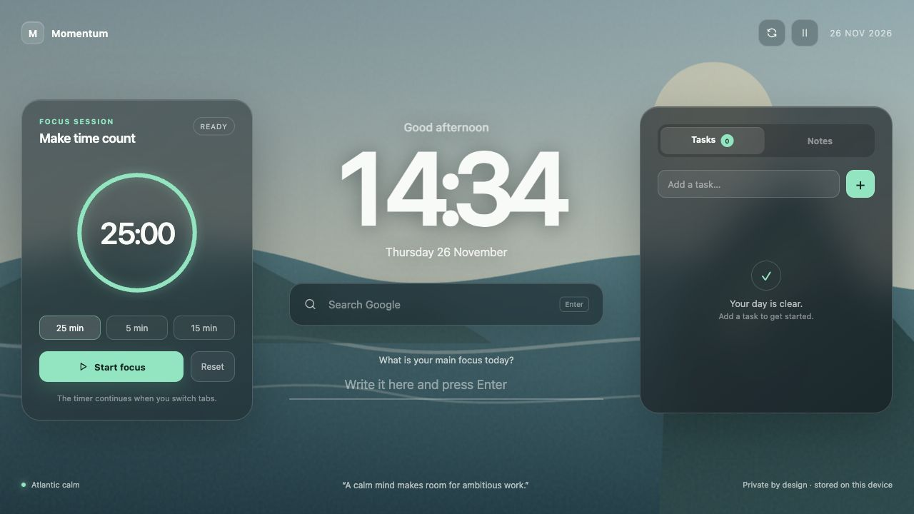

# Momentum Focus Dashboard

A privacy-friendly Chrome new-tab extension for focused work. It combines a live clock and greeting, a daily priority, Google search, a persistent focus timer, tasks, notes, and rotating illustrated landscapes.



## Purpose

This project is a Momentum Dash replica built as an original Manifest V3 extension. It replaces Chrome's default new-tab page with a calm dashboard that keeps the user's priority and small productivity tools immediately available.

## Data collection

The extension does not passively collect data from the web or use a remote API.

- The clock, date, and greeting come from the browser's local `Date` value.
- The focus text, tasks, notes, timer actions, and background preference come from direct user input.
- Backgrounds and quotes are bundled in this repository.
- Google receives a search query only when the user intentionally submits the search form.

There is no account, analytics service, advertising, telemetry, or API key. See [PRIVACY.md](PRIVACY.md) for the data-handling summary.

## Data persistence

The extension stores the daily focus, tasks and completion state, notes, timer state, selected background, and rotation preference in `chrome.storage.local`. This keeps the data in the user's Chrome profile rather than sending it to a project server.

The focus timer stores an absolute end time and creates a `chrome.alarms` alarm. This lets the Manifest V3 service worker stop and restart without losing a running session. A browser-preview fallback uses `localStorage`, but notification and background-timer behaviour should be verified in Chrome as an installed extension.

## User interaction

- Read the clock, greeting, and daily quote when opening a new tab.
- Enter a daily focus and press Enter (or leave the field) to save it.
- Start, pause, reset, or choose a 5, 15, or 25 minute timer.
- Add, complete, delete, and clear tasks.
- Write notes that save automatically.
- Search Google, change the background manually, or pause background rotation.

## Setup and run

### Requirements

- Google Chrome or another Chromium browser that supports unpacked Manifest V3 extensions
- No runtime dependencies, API key, server, build step, or configuration file
- Optional: Node.js 18 or newer to run the structural tests

### Install locally

1. Download or clone this repository.
2. Open `chrome://extensions`.
3. Enable **Developer mode**.
4. Select **Load unpacked**.
5. Choose this repository folder.
6. Open a new tab.

After changing the code, select the extension's reload button in `chrome://extensions`.

### Test

```bash
npm test
```

The tests use Node's built-in test runner and syntax checker; no package installation is required.

## Project structure

| File or folder | Purpose |
| --- | --- |
| `manifest.json` | Manifest V3 permissions, icons, service worker, and new-tab override |
| `newtab.html` | Semantic dashboard markup |
| `newtab.css` | Responsive dashboard styling and reduced-motion support |
| `newtab.js` | Clock, search, tasks, notes, focus, and background behaviour |
| `background.js` | Persistent timer state, alarms, and completion notification |
| `images.js` and `assets/backgrounds/` | Bundled quote and background catalogue |
| `tests/` | Dependency-free structural smoke tests |
| `PRODUCT_SPEC.md` | Scope and acceptance criteria |
| `PRIVACY.md` | Plain-language data handling summary |

## Learning, challenge, and solution

The main implementation challenge visible in this project is keeping a timer reliable when a Manifest V3 service worker is not continuously running. The solution is to persist the timer's end time, use a Chrome alarm for completion, and recalculate the remaining time whenever state is read. The project also demonstrates how extension permissions, local persistence, accessible controls, and a responsive interface fit together without a framework or build tool.

This is an evidence-based summary of the implementation. The student should be prepared to explain these decisions in their own words and personalize the reflection if their own learning emphasis was different.

## Limitations

- The extension is designed and manually demonstrated for Chrome/Chromium; Firefox and Safari packaging were not implemented.
- Data stays in one Chrome profile and is not synchronized between profiles or devices.
- The notification depends on Chrome notification settings.
- Google is the only search provider.
- Automated tests check structure and JavaScript syntax, not every visual or browser-extension interaction.
- The plain-browser preview fallback cannot reproduce service-worker alarms or Chrome notifications.

## Assistance, tools, and external code

This project was created and reviewed with assistance from ChatGPT/Codex for planning, code generation and refinement, test creation, documentation, and repository review. The implementation uses standard HTML, CSS, JavaScript, Node's built-in test runner, and documented Chrome extension APIs. No third-party JavaScript library is bundled. The four background illustrations and icons are repository assets; Google is contacted only after an explicit search.

## Version history

- **v1.0.0** - first complete course version

Built for the Applied Programming & AI Fundamentals course.
